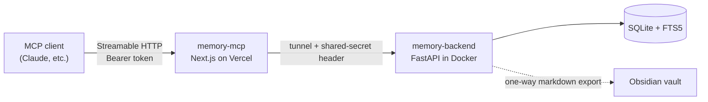

# memory-mcp

A remote [MCP](https://modelcontextprotocol.io) server that gives AI assistants a shared, persistent memory. Context saved in one chat (Claude, or any MCP client) can be searched and retrieved from another, and the data lives on my own hardware instead of with any one provider.

This repo is the **front door**, a Next.js app on Vercel that handles OAuth and speaks MCP. The storage layer is a separate service: [memory-backend](https://github.com/hitrohitro/memory-backend).

<!-- Demo: add a GIF or video link here -->

## Architecture

## Tools

| Tool | What it does |
|---|---|
| `save_context` | Save a decision, fix, or state change as a short standalone entry (title, summary, details, tags, machine, source) |
| `search_context` | Full-text search over saved entries |
| `get_recent` | Most recent entries, optionally filtered by machine, for catching up at the start of a chat |
| `update_context` | Correct or extend an existing entry by id instead of saving a duplicate |

## Auth

A minimal, **stateless OAuth 2.1** implementation, so no database is needed on Vercel:

- **PKCE** (S256) and **dynamic client registration**, so MCP clients can connect on their own.
- Authorization codes, access tokens, and refresh tokens are **HMAC-SHA256-signed** and carry a type and expiry. Lifetimes: codes 5 minutes, access tokens 30 days, refresh tokens 365 days.
- The signing key is derived from `MCP_KEY`, and so is the sign-in passphrase. Rotating `MCP_KEY` in Vercel instantly invalidates every client and token.
- Token and passphrase checks use constant-time comparison.
- Unauthenticated requests get a `401` with a `WWW-Authenticate` header that points to the OAuth protected-resource metadata.
- The backend secret never reaches the client. Only this server holds it and forwards it to the backend.
- Tool inputs are validated with zod (type and length limits), and backend calls time out after 8 seconds.
- The backend also rejects entries that look like they contain credentials.

**Trade-off:** because tokens are stateless, you can't revoke a single token. Rotating `MCP_KEY` is the revoke-everything switch.

## Environment variables

Set these in the Vercel project settings. Never commit them.

| Variable | Purpose |
|---|---|
| `MCP_KEY` | Random string (32+ chars); the sign-in passphrase and the token signing secret |
| `BACKEND_URL` | Public tunnel URL of the backend, no trailing slash |
| `BACKEND_SECRET` | Must match `BACKEND_SECRET` on the backend |

## Setup

1. Run the backend: see [memory-backend](https://github.com/hitrohitro/memory-backend). The image is `ghcr.io/hitrohitro/memory-backend`.
2. Expose it through a tunnel (Cloudflare Tunnel, Tailscale Funnel, etc.).
3. Fork or clone this repo and import it into Vercel.
4. Set the three environment variables above and deploy.
5. In your MCP client, add a custom connector pointing to `https://<your-app>.vercel.app/api/mcp` and sign in with your passphrase.

## Stack

Next.js, TypeScript, `mcp-handler`, `@modelcontextprotocol/sdk`, zod. Backend: FastAPI, SQLite (FTS5/BM25), Docker.
